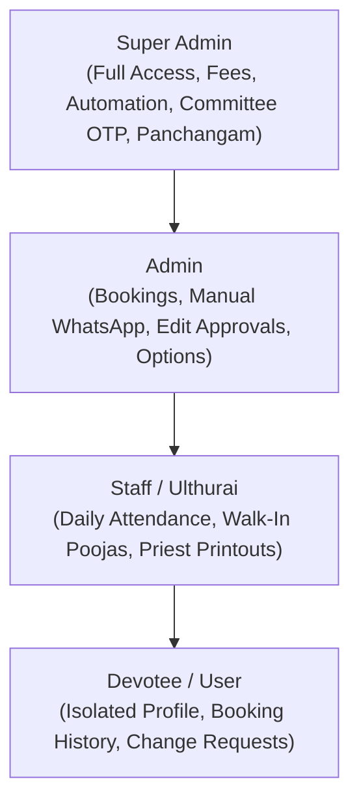
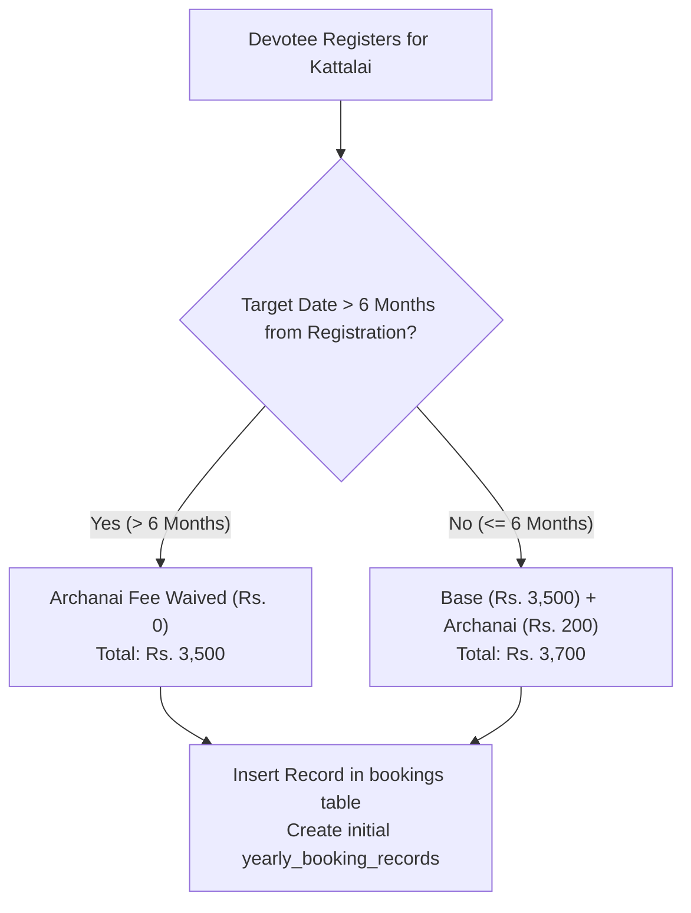
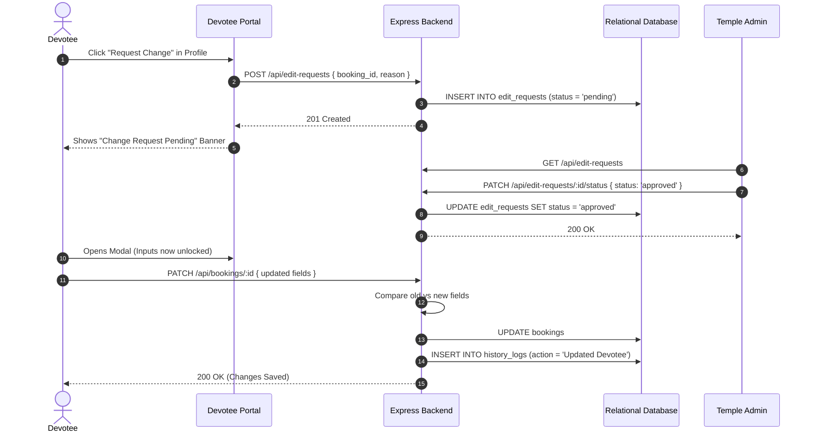
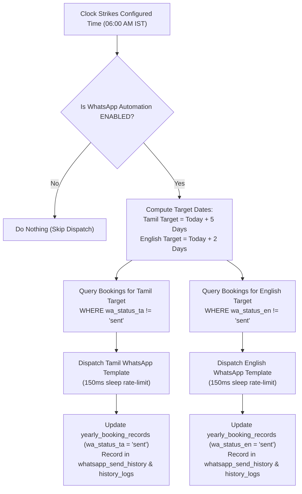
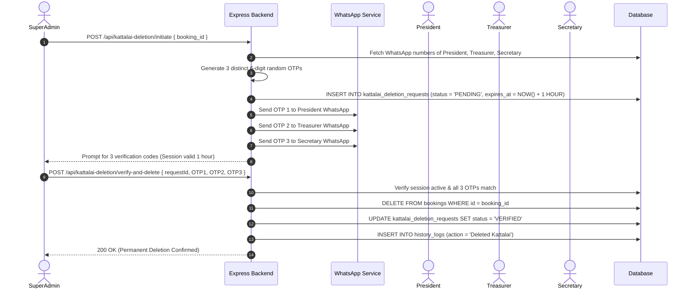

# VAIRAVAN KOIL: END-TO-END TECHNICAL AND FUNCTIONAL SYSTEM MANUAL

**Project Name**: Vairavan Kovil - Nagarathar Dharma Paripalana Sabai  
**Document Version**: 3.0 (Complete System Architecture and Engineering Logic Reference)  
**Last Updated**: November 12, 2026  
**Author**: Engineering and Architecture Team  

---

## TABLE OF CONTENTS
1. [Executive Summary and System Architecture](#1-executive-summary-and-system-architecture)
2. [Role-Based Access Control (RBAC) and Devotee Isolation Defense](#2-role-based-access-control-rbac-and-devotee-isolation-defense)
3. [Devotee Authentication, Flexible Identifiers and Password Security](#3-devotee-authentication-flexible-identifiers-and-password-security)
4. [Endowment and Booking Business Logic (The 6-Month Threshold Formula)](#4-endowment-and-booking-business-logic-the-6-month-threshold-formula)
5. [Hereditary Account Transfer Mathematical Engine](#5-hereditary-account-transfer-mathematical-engine)
6. [Devotee Edit and Administrative Approval Lifecycle (Zero-Cost Unlock)](#6-devotee-edit-and-administrative-approval-lifecycle-zero-cost-unlock)
7. [Pooja Attendance Engine and 5-Day Grace Lock Period](#7-pooja-attendance-engine-and-5-day-grace-lock-period)
8. [Thani Archanai / Thuritha Kattalai (Walk-In Daily Poojas)](#8-thani-archanai--thuritha-kattalai-walk-in-daily-poojas)
9. [Panchangam Astronomical Engine and In-Memory Calendar Caching](#9-panchangam-astronomical-engine-and-in-memory-calendar-caching)
10. [WhatsApp Notification, Campaign and Automation Engine](#10-whatsapp-notification-campaign-and-automation-engine)
11. [Power Users and WhatsApp 3-Party Multi-Signature OTP Protocol](#11-power-users-and-whatsapp-3-party-multi-signature-otp-protocol)
12. [Payment and Receipt Gateway Architecture (Razorpay and Offline)](#12-payment-and-receipt-gateway-architecture-razorpay-and-offline)
13. [Postal Letter Intimation and Print Tracking Architecture](#13-postal-letter-intimation-and-print-tracking-architecture)
14. [Bilingual Architecture and Dual-Column Tamil Localization](#14-bilingual-architecture-and-dual-column-tamil-localization)
15. [Support Ticketing and Bug Reporting Subsystem](#15-support-ticketing-and-bug-reporting-subsystem)
16. [Audit Trails, Categorized History Logs and QA Test Suite](#16-audit-trails-categorized-history-logs-and-qa-test-suite)

---

## 1. Executive Summary and System Architecture

### 1.1 Overview
The **Vairavan Kovil Web Application** is a specialized temple enterprise resource and endowment administration platform engineered specifically for the **Nagarathar Dharma Paripalana Sabai**. It administers perpetual and walk-in spiritual endowments (Nithiya Kattalais and Thani Archanai), Tamil panchangam calendars, automated bilingual WhatsApp intimations, multi-signature committee authorizations, and financial accounting.

### 1.2 Technology Stack
* **Frontend**:
  * **Framework**: React 18 with Vite build tooling.
  * **Styling**: Tailwind CSS tailored with the authentic Chettinad heritage palette:
    * Chettinad Deep Crimson: `#5c292c`
    * Warm Temple Sand / Cream: `#f7f1e5`
    * Gold / Amber Accents: `#fbb12f`
    * Forest Green: `#2e7d32`
  * **Icons**: Lucide React.
  * **State Architecture**: Reactive hooks (`useState`, `useEffect`, `useCallback`) with client-side Map caching for zero-latency interactions.
* **Backend**:
  * **Runtime**: Node.js (v18+) with Express.js REST API.
  * **Security**: Helmet HTTP protection, CORS isolation, bcryptjs (10 rounds) salt hashing, JSON Web Tokens (JWT, 24-hour expiration), IP rate limiting on authentication routes.
  * **Scheduling**: Native Indian Standard Time (IST, UTC+5:30) background cron scheduler (`whatsappAutomationService.js`) running on automated intervals.
* **Database Layer**:
  * **Engine**: Relational MySQL 8.0+ / PostgreSQL compatibility layer (`pool.js` with automatic translation for `$1, $2` and `?` parameterization).
  * **Key Tables**: `bookings`, `kattalai_types`, `system_settings`, `yearly_booking_records`, `thuritha_kattalais`, `whatsapp_send_history`, `history_logs`, `panchangam_records`, `dropdown_options`, `users`, `power_users`, `kattalai_deletion_requests`, `bug_reports`, `todo_lists`, `todo_items`, `devotee_passwords`, `payments`, `print_records`, `edit_requests`.

---

## 2. Role-Based Access Control (RBAC) and Devotee Isolation Defense

The platform enforces strict role boundaries and data isolation across four distinct tiers:

### 2.1 Role Capabilities Matrix

| Feature / Action | Devotee (`user`) | Ulthurai (`staff`) | Admin (`admin`) | Super Admin (`superadmin`) |
| :--- | :---: | :---: | :---: | :---: |
| Public Online Signup and Slot Browsing | Yes | Yes | Yes | Yes |
| View Own Booking and Pooja Attendance History | Yes (Strictly Own) | Yes | Yes | Yes |
| View All Devotee Profiles / Search Members | No (Blocked) | Yes | Yes | Yes |
| Multi-Format Code Login (A/1/01, a 1 01, A-1-01) | Yes | Yes | Yes | Yes |
| Submit Profile Change Request | Yes | No | No | No |
| Approve / Reject Devotee Change Requests | No | No | Yes | Yes |
| Mark Daily Pooja Attendance (Within 5 Days) | No | Yes | Yes | Yes |
| Override Past Attendance (Beyond 5 Days) | No | No | No | Yes |
| Mark Walk-In Thuritha Attendance | No | Yes | Yes | Yes |
| Manual WhatsApp Campaign Dispatch | No | No | Yes | Yes |
| Configure Daily Automated WhatsApp Scheduler | No | No | No | Yes |
| Configure System Fees and Endowment Rates | No | No | No | Yes |
| Upload / Edit Panchangam Data | No | No | Yes | Yes |
| Initiate Kattalai Deletion via WhatsApp OTP | No | No | No | Yes |
| Configure Power User Committee Profiles | No | No | No | Yes |
| Manage Staff Accounts and Privileges | No | No | No | Yes |

### 2.2 Devotee Isolation Defense Mechanics
* **Public Slot Masking**: Unauthenticated users or devotees browsing the calendar grid receive masked slot representations. Devotee names, contact numbers, and addresses are stripped, rendering slots merely as "Booked" to guarantee total privacy.
* **Database Query Guard**: On all `/api/bookings` and `/api/history` endpoints, if `req.user.role === 'user'`, the query strictly binds to `WHERE b.id = req.user.id`. Any direct tampering with query parameters to access other records results in immediate HTTP `403 Forbidden`.

---

## 3. Devotee Authentication, Flexible Identifiers and Password Security

### 3.1 Flexible Identifier Sanitization Engine
Devotees frequently recall their Office Code in varied notations. The authentication engine in `authController.js` normalizes the identifier automatically:
* Supported formats: `A/1/01`, `a 1 01`, `A-1-01`, `a101`, `U/2/15`
* Sanitization logic: removes whitespace, slashes, and hyphens before comparing against database records.
* Devotees can also log in seamlessly with their **registered email address**.

### 3.2 Dual-Tier Password Verification Architecture
Devotees do not require complex initial setups:
1. **Custom Password Mode**: If the devotee has previously set a custom password, the system checks `devotee_passwords.password_hash` using `bcrypt.compare()`.
2. **Default Password Fallback**: If no custom password exists, the system compares the submitted password against the devotee's registered **10-digit mobile number** or **WhatsApp number** (stripping country codes, whitespace, and leading zeros).
3. **Password Management**: Devotees can update their password at any time via `ChangePasswordModal.jsx` (`POST /api/auth/change-password`), which hashes the new secret with bcrypt (10 salt rounds) and marks `is_custom_password = 1`.

---

## 4. Endowment and Booking Business Logic (The 6-Month Threshold Formula)

### 4.1 Nithiya Kattalai Classification
1. **Uchikala Kattalai (Uchikkalam)**: Mid-day temple pooja scheduled daily at **11:30 AM** (Office Code prefix: `U/`).
2. **Arthajama Kattalai (Arthajamam)**: Night temple pooja scheduled daily at **07:30 PM** (Office Code prefix: `A/` or `AJ/`).

### 4.2 The 6-Month Date Threshold Pricing Formula
The Sabai bylaws dictate that long-term endowments booked far in advance receive a waiver on the initial year's archanai expense:

$$\text{Lead Time} = \text{Target Pooja Date} - \text{Registration Date}$$

$$\text{Final Payable Amount} = 
\begin{cases} 
\text{Base Endowment (Rs. 3,500)}, & \text{if Lead Time } > 6 \text{ Months} \\
\text{Base (Rs. 3,500)} + \text{Archanai Fee (Rs. 200)} = \mathbf{Rs.\ 3,700}, & \text{if Lead Time } \le 6 \text{ Months}
\end{cases}$$

### 4.3 Slot Collision Prevention
Every booking validates that the tuple `(code, kattalai_month, kattalai_date)` is strictly unique. If a collision is attempted, the database transaction rolls back and returns HTTP `400 Bad Request`.

---

## 5. Hereditary Account Transfer Mathematical Engine

Under Nagarathar community traditions, kattalais can be passed down hereditary lines under strictly enforced criteria:

### 5.1 Bylaw Eligibility Rules
1. **1-Time Lifetime Rule**: A kattalai can be transferred **only once** in its lifetime. If `is_transferred = 1` or `transferred_at IS NOT NULL`, subsequent transfer attempts are rejected (`HTTP 400`).
2. **Gender and Lineage Validation**: Under Sabai guidelines, transfers are strictly valid for male heirs holding the honorific title **"Thiru"** or **"Selvan"**. Accounts under **"Thirumathi"** or **"Selvi"** cannot be transferred.
3. **Category Reclassification**: Upon successful transfer, the booking category (`kat_type`) is permanently updated to **"Inheritance"**. The original donor's name and title are preserved in `transferred_from_name` and `transferred_from_title`.

### 5.2 Mathematical Difference Calculation
The system calculates the differential fee payable by the incoming heir based on dynamic system settings:

$$\text{Difference Payable} = \max\Big(0, \text{Current Base Endowment} - \text{Prior Historical Deposit}\Big) + \text{Extra Transfer Fee}$$

* **Default Calculation Values**:
  * Current Base Endowment: **Rs. 3,500**
  * Prior Historical Deposit: **Rs. 1,200**
  * Extra Transfer / Archanai Fee: **Rs. 200**
  * **Total Difference Collected**: $(Rs.\ 3,500 - Rs.\ 1,200) + Rs.\ 200 = \mathbf{Rs.\ 2,500}$.
* Upon execution, the payment is automatically logged in `payments`, and an immutable entry is written to `history_logs` under the `transfers_requests` category.

---

## 6. Devotee Edit and Administrative Approval Lifecycle (Zero-Cost Unlock)

Devotees cannot directly alter sacred endowment records without administrative verification:

### 6.1 Field-by-Field Diff Generation
When an approved booking is updated, `bookingsController.js` computes an exact delta:
> `Administrator updated devotee [Code: A/1/01]. Changes: Name: "Marlin" -> "Marlin S", Phone: "9876543210" -> "9876543211", Star: "Anusam" -> "Aswini".`

---

## 7. Pooja Attendance Engine and 5-Day Grace Lock Period

### 7.1 Attendance Status Tracking
Every year's pooja cycle is tracked per devotee in `yearly_booking_records`:
* `attendance_status`: `'present'` or `'absent'`
* `marked_by_user_id`: Staff member who recorded the status
* `marked_at`: Timestamp of attendance entry

### 7.2 The 5-Day Lock Window Policy
To prevent tampering with historical pooja records:
* **Staff / Ulthurai**: Permitted to mark or toggle attendance only within **5 days** of the scheduled pooja date:

$$|\text{Booking Date} - \text{Current Date}| \le 5 \text{ days}$$

* **Superadmin Override**: If an attendance record requires modification beyond the 5-day window ($> 5\text{ days}$), the action is blocked for regular staff (`HTTP 403`) and can **only be performed by a Superadmin**.
* Devotees have read-only access to their past yearly attendance records via the **My History** tab (`MyHistory.jsx`).

---

## 8. Thani Archanai / Thuritha Kattalai (Walk-In Daily Poojas)

### 8.1 Purpose and Architecture
Thuritha Kattalai serves pilgrims and walk-in devotees visiting the temple on the day of worship who wish to have an immediate archanai performed without establishing an annual perpetual endowment.

### 8.2 Data Model (`thuritha_kattalais`)
* `id`: UUID Primary Key.
* `name`: Devotee Name.
* `place`: Native village / residence.
* `mobile`: 10-digit mobile number.
* `star`: Birth star (dropdown sourced from database `dropdown_options`).
* `amount`: Fixed fee (default **Rs. 200**, configurable in System Settings).
* `attendance_status`: `'present'` or `'absent'` (default: `'absent'`).
* `date`: Worship date (`YYYY-MM-DD`).

### 8.3 Operational Flow
Devotees register online via `/thuritha-kattalai-register` or at the temple counter. The record instantly streams to the **Ulthurai Dashboard**, where staff verify physical presence and toggle attendance before the priests begin the archana rituals.

---

## 9. Panchangam Astronomical Engine and In-Memory Calendar Caching

The application integrates an astronomical Panchangam engine that pairs every Gregorian calendar date with traditional Tamil calendar data.

### 9.1 Astronomical Data Schema
* **Auspicious Timings**: Nalla Neram (Auspicious Time), Gauri Nalla Neram (Gauri Auspicious Time).
* **Inauspicious Periods**: Raagu Kaalam (Rahu Kalam), Emakandam (Yama Gandam), Kuligai (Gulika).
* **Astronomical Attributes**: Thithi and Timing, Natchathiram (Star), Yogam.
* **Astrological Guides**: Chandrashtamam, Soolam, Parigaaram.
* **Devotional Highlights**: Sirappu (Special Events), Vazhipadu (Deity Worship Guidance).

### 9.2 In-Memory Caching Architecture
To guarantee smooth, instantaneous date browsing without lag:
* The frontend maintains a Map cache: `panchangamCache = new Map()`.
* Browsing across dates fetches data once and caches it in memory.
* When administrators upload a new annual CSV or submit manual corrections, the cache is instantly cleared via `api.clearPanchangamCache()`.

---

## 10. WhatsApp Notification, Campaign and Automation Engine

The WhatsApp subsystem handles both **Manual Campaigns** and **Automated Daily Dispatches** via the Meta WhatsApp Cloud API.

### 10.1 Dynamic Template Variable Mapping
Both English (`WHATSAPP_TEMPLATE_ENGLISH`) and Tamil (`WHATSAPP_TEMPLATE_TAMIL`) templates utilize official gopuram header media and 8 dynamic variable slots:

| Variable Slot | English Parameter | Tamil Parameter | Example Value |
| :---: | :--- | :--- | :--- |
| `{{1}}` | Office Code | Office Code | `A/1/01` |
| `{{2}}` | Devotee Title | Native Place | `Thiru` / `Karaikudi` |
| `{{3}}` | Devotee Name | Devotee Title | `Marlin` / `Thiru` |
| `{{4}}` | Kattalai Name | Devotee Name | `Uchikkalam` / `Marlin` |
| `{{5}}` | Formatted Date | Kattalai Name | `24.Sep.26` / `Uchikkalam` |
| `{{6}}` | Pooja Time | Formatted Date | `11:30 AM` / `24.Sep.26` |
| `{{7}}` | Devotee Place | Birth Star | `Karaikudi` / `Anusam` |
| `{{8}}` | Birth Star | Pooja Time | `Anusam` / `11:30 AM` |

### 10.2 Manual Campaign Engine (WhatsApp Dashboard)
* **Date Range Filter**: Select upcoming pooja dates up to 5 days ahead.
* **Row Checkboxes**:
  * Master Checkbox in table header toggles all devotees simultaneously.
  * Individual row checkboxes allow unticking specific devotees.
  * Selected devotee IDs (`selectedBookingIds`) are delivered in the dispatch payload.
* **Dynamic Action Buttons**: Display live count (e.g., `Send English (2)`) and dispatch only to selected rows.

### 10.3 Automated Daily Dispatch Scheduler (`whatsappAutomationService.js`)
* **Daily Trigger**: Runs automatically at **06:00 AM IST** (configurable in System Settings).
* **Multi-Day Lead Architecture**:
  * For poojas scheduled on date $D$:
    * **Tamil Reminder**: Dispatches automatically on date $D - 5$ (or configured Tamil lead days).
    * **English Reminder**: Dispatches automatically on date $D - 2$ (or configured English lead days).
* **Zero Duplication Guarantee**: Every dispatch records its state in `yearly_booking_records`:
  * English: `wa_status_en = 'sent'`
  * Tamil: `wa_status_ta = 'sent'`
  * Subsequent cron runs strictly query `WHERE wa_status IS NULL OR wa_status != 'sent'`, preventing double-sends.
* **Rate Limiting**: Includes a 150ms sleep between individual message dispatches to honor Meta API limits.

---

## 11. Power Users and WhatsApp 3-Party Multi-Signature OTP Protocol

To protect permanent temple endowments against accidental or unauthorized deletion, the platform implements a 3-party cryptographic approval mechanism.

### 11.1 The 5 Power User Roles
The temple executive committee consists of 5 designated roles stored in `power_users`:
1. **President** - Mandatory Signatory
2. **Treasurer** - Mandatory Signatory
3. **Secretary** - Mandatory Signatory
4. **Vice President**
5. **Joint Secretary**

Superadmins configure the full legal names, WhatsApp phone numbers, and native places for each Power User in `/profiles`.

### 11.2 Deletion Multi-Signature Lifecycle
Kattalais cannot be deleted directly. The deletion process requires a 3-party verification flow:

1. **Initiation**: Superadmin requests deletion. The system verifies that WhatsApp numbers are configured for President, Treasurer, and Secretary.
2. **Generation**: The system creates 3 unique 6-digit cryptographic OTPs and stores the request with a **1-hour expiration** (`DATE_ADD(NOW(), INTERVAL 1 HOUR)`).
3. **Dispatch**: The backend delivers individual OTPs to each official's WhatsApp via `sendPowerUserOtp`.
4. **Verification**: Superadmin enters all 3 OTPs. If any OTP is incorrect or the 1-hour window has expired, the deletion is rejected.
5. **Execution and Audit**: Upon verification, the booking is deleted, and a permanent audit trail is written to `history_logs`.

---

## 12. Payment and Receipt Gateway Architecture (Razorpay and Offline)

The financial layer tracks both digital online sponsorships and temple counter cash/challan receipts.

### 12.1 Payment Methods
* **Online (Razorpay / UPI / Cards)**: Integrated via `paymentsController.js`.
* **Offline (Cash / Cheque / Bank Transfer)**: Recorded directly by temple staff.

### 12.2 Cryptographic Verification
For Razorpay transactions, the backend calculates an HMAC SHA-256 signature to verify authenticity before recording:

$$\text{Expected Signature} = \text{HMAC-SHA256}(\text{order\_id} + "|" + \text{payment\_id}, \text{RAZORPAY\_SECRET})$$

If the signature matches (or if operating in development mock mode), the payment is inserted into `payments` with `status = 'paid'`, and an audit record is logged in `history_logs` under the `finance` category.

---

## 13. Postal Letter Intimation and Print Tracking Architecture

For elderly devotees or those without digital access, the application provides physical postal dispatch workflows.

### 13.1 Print Workflows
* **Daily Pooja Dispatch Sheets**: Formatted for temple archakars, grouping the day's Uchikalam and Arthajamam sponsors.
* **Postal Letter Intimations**: Pre-formatted for standard window envelopes, displaying devotee communication addresses (`comm_add_1` to `comm_add_4`).
* **Letter Intimation Toggle (`let_intimation`)**: A boolean flag (`0` or `1`) tracking whether postal letters are enabled for a devotee.

### 13.2 Ordinal Print Tracking
Every print run is tracked in the `print_records` table:
* Tracks user ID, user name, target pooja date, and devotee count.
* Automatically assigns ordinal print run numbers: **1st Print**, **2nd Print**, **3rd Print**, etc.
* Provides staff with instant visibility into reprint counts and physical dispatch history.

---

## 14. Bilingual Architecture and Dual-Column Tamil Localization

The platform features end-to-end bilingual support across both English and Tamil.

### 14.1 Dual-Column Database Strategy
To avoid lossy translation and allow devotees to record traditional Tamil spellings, key tables feature dual columns:
* `title` / `title_ta`: English honorific (`Thiru`) vs Tamil (`திரு`).
* `name` / `name_ta`: Devotee legal name vs Tamil script.
* `star` / `star_ta`: Birth star in English (`Anusam`) vs Tamil (`அனுஷம்`).
* `place` / `place_ta`: Native village in English (`Karaikudi`) vs Tamil (`காரைக்குடி`).
* `kattalai_types.name` / `name_ta`: Pooja name in English (`Uchikkalam`) vs Tamil (`உச்சிக்காலம்`).

### 14.2 UI Language Toggle
The header includes an instant language switcher (`A` / `அ`). Clicking toggles between English and Tamil interfaces without reloading the application. Devotee Tamil details can also be inspected and updated via `TamilDetailsModal.jsx`.

---

## 15. Support Ticketing and Bug Reporting Subsystem

To capture issues directly from temple staff and devotees, the platform provides an integrated bug reporting suite.

### 15.1 Multi-File Upload and Security Controls
* **Upload Path**: Saved to `uploads/bug_reports/`.
* **File Restrictions**: Strict image-only whitelist (`jpeg|jpg|png|webp|gif`), 10MB file size ceiling, and maximum 5 attachments per report.
* **Metadata Capture**: Automatically records reporting user, role, page URL, timestamp, and issue description.

### 15.2 Ticket Lifecycle
Bug tickets progress through four standardized states:
1. `open` - Newly submitted.
2. `in_progress` - Under investigation.
3. `resolved` - Fix deployed.
4. `closed` - Verified by administrator.

---

## 16. Audit Trails, Categorized History Logs and QA Test Suite

### 16.1 12 Functional Audit Categories
All system events are permanently preserved in `history_logs` and categorized for administrative reporting:
1. `registrations` - New kattalai bookings.
2. `deletions` - 3-OTP verified kattalai deletions.
3. `updates` - Field-by-field devotee profile edits.
4. `transfers_requests` - Hereditary transfers and change requests.
5. `attendance` - Daily pooja attendance marks and overrides.
6. `printing` - Daily sheets and postal letter intimation printouts.
7. `whatsapp` - Manual and automated reminder dispatches.
8. `finance` - Cash receipts, online payments and differences.
9. `committee_staff` - Staff accounts and Power User updates.
10. `settings_panchangam` - System fees, scheduler and calendar updates.
11. `bugs` - Support tickets and status transitions.
12. `security_logins` - Devotee and staff authentication events.

### 16.2 Automated Quality Assurance Test Suites
The codebase is validated by comprehensive automated test suites:
* **`backend/test_pro_senior_qa.js` (43 Test Cases)**:
  * Full HTTP lifecycle: registration, slot conflict prevention, public slot blurring.
  * Multi-format code logins (`A/1/01`, `a 1 01`, `A-1-01`).
  * 1-Time transfer eligibility, male lineage validation, and math precision (Rs. 2,500 collection).
  * 6-Month threshold pricing waiver calculations.
  * Parallel registration concurrency stress tests.
* **`backend/test_whatsapp_automation_qa.js` (100% Pass Rate)**:
  * 12-Hour AM/PM to 24-Hour time conversion roundtrips.
  * IST target date calculations ($D - 5$ for Tamil, $D - 2$ for English).
  * Devotee row selection filtering (`selectedBookingIds`).
  * Lead day and time format input validation.

---

*End of Technical Manual. Maintained in the repository root as [END_TO_END_SYSTEM_MANUAL.md](file:///c:/Users/marlin/OneDrive/Desktop/workss/vairavan_koil_app/END_TO_END_SYSTEM_MANUAL.md).*
