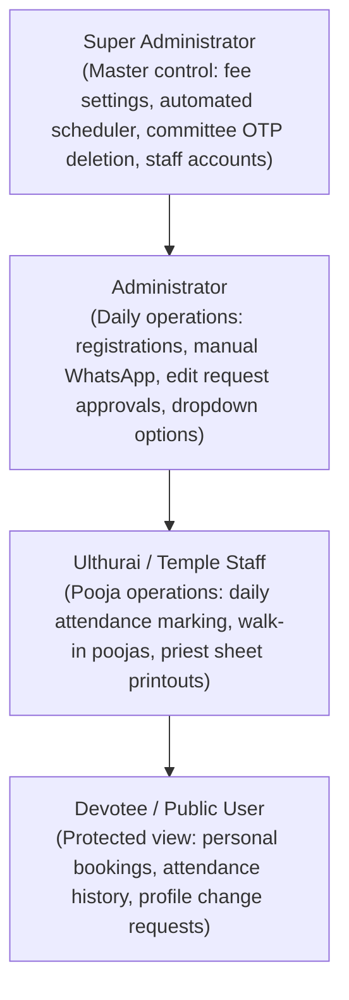
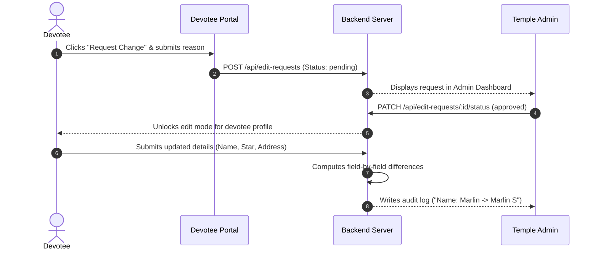
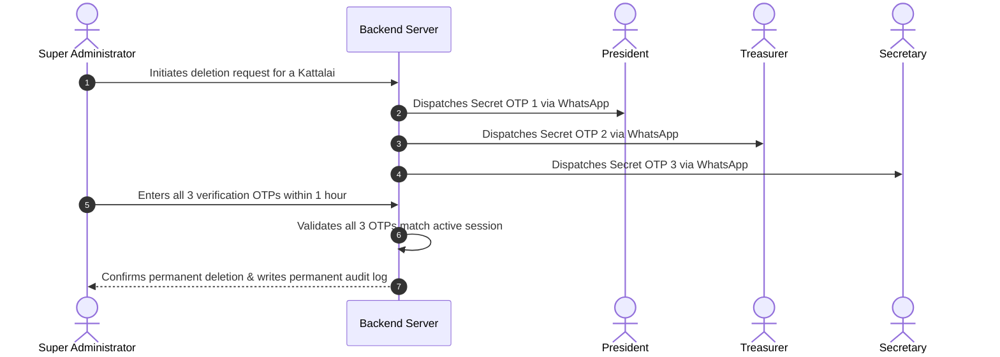

# Vairavan Kovil – System Operations & Engineering Manual

**Nagarathar Dharma Paripalana Sabai – Vairavan Kovil**  
**Document Reference:** End-to-End System Manual  
**Last Updated:** November 2026  

---

## 1. Overview & System Purpose

The Vairavan Kovil application is the primary administration and endowment management platform for the **Nagarathar Dharma Paripalana Sabai**. The platform coordinates the entire lifecycle of temple poojas, financial endowments, devotee records, and automated communications.

The temple manages two primary types of worship:

1. **Nithiya Kattalai (Perpetual Annual Endowment):**  
   Devotees sponsor a recurring annual pooja slot on a fixed calendar day for their lifetime. Each year on that scheduled date, the temple conducts the pooja in the devotee's name, records attendance, delivers automated WhatsApp reminders, and prepares postal prasatham dispatches.
2. **Thuritha Kattalai / Thani Archanai (Walk-In Daily Archanai):**  
   Walk-in pilgrims visiting the temple counter or online registrants requesting an immediate, one-time archanai on that day without creating an annual perpetual endowment.

### System Architecture
* **Frontend:** Built with React 18 and Vite, styled using Tailwind CSS in Chettinad temple colors (deep crimson maroon `#5c292c`, warm cream sand `#f7f1e5`, and temple gold). Includes an instant bilingual toggle (`A` / `அ`).
* **Backend:** Node.js and Express.js REST API operating on Indian Standard Time (IST, UTC+5:30).
* **Database:** Managed MySQL on Aiven Cloud (`defaultdb`) with 19 relational tables tracking bookings, payments, Panchangam calendars, and audit logs.

---

## 2. User Roles & Permission Matrix

The application defines four distinct user roles to maintain clear operational boundaries and protect devotee privacy:

### Role Capabilities:

| Feature / Action | Devotee | Ulthurai (Staff) | Admin | Super Admin |
| :--- | :---: | :---: | :---: | :---: |
| Browse available slots on public registration | Yes (Masked) | Yes | Yes | Yes |
| View own booking & pooja attendance history | Strictly Own | Yes | Yes | Yes |
| Search other devotees / view all member profiles | ❌ Blocked | Yes | Yes | Yes |
| Multi-format office code login (`A/1/01`, `a 1 01`, `A-1-01`) | Yes | Yes | Yes | Yes |
| Submit profile change request | Yes | ❌ | ❌ | ❌ |
| Approve or reject devotee change requests | ❌ | ❌ | Yes | Yes |
| Mark daily attendance (within 5 days of pooja) | ❌ | Yes | Yes | Yes |
| Override past attendance (older than 5 days) | ❌ | ❌ | ❌ | Yes |
| Manage walk-in Thuritha Kattalais | ❌ | Yes | Yes | Yes |
| Dispatch manual WhatsApp campaigns | ❌ | ❌ | Yes | Yes |
| Configure daily automated WhatsApp scheduler | ❌ | ❌ | ❌ | Yes |
| Configure system fees & endowment rates | ❌ | ❌ | ❌ | Yes |
| Upload & update Panchangam calendar CSV | ❌ | ❌ | Yes | Yes |
| Permanently delete a Kattalai (via 3 Committee OTPs) | ❌ | ❌ | ❌ | Yes |
| Configure Power User committee profiles | ❌ | ❌ | ❌ | Yes |
| Manage staff accounts & privileges | ❌ | ❌ | ❌ | Yes |

### Devotee Privacy Controls:
* **Public Slot Masking:** When public visitors or devotees view the calendar grid to choose a date, all booked slots are masked and labeled simply as "Booked". Devotee names, phone numbers, and addresses are stripped out on the server before transmitting data.
* **Database Query Guard:** When a devotee logs in, all query routes automatically enforce `WHERE b.id = req.user.id`. Any direct attempt to request another devotee's ID via API parameters returns `HTTP 403 Forbidden`.

---

## 3. Devotee Authentication & Flexible Office Code Login

Devotees often write or recall their Office Code in different notations. The authentication service normalizes code formats automatically to ensure seamless access.

### 1. Flexible Code Matching:
The backend accepts and normalizes any of the following formats:
* `A/1/01` (Standard format)
* `a 1 01` (Lowercase with spaces)
* `A-1-01` (Hyphen-separated)
* `a101` (Continuous text)
* Or the devotee's **registered email address**

Spaces, hyphens, and slashes are sanitized before querying the database, matching the devotee record without requiring exact punctuation.

### 2. Password Verification:
* **Custom Password:** If a devotee has set a personal password, it is verified using bcrypt hashing (`devotee_passwords.password_hash`).
* **Default Fallback:** If a devotee has not yet configured a personal password, their registered **10-digit mobile number** (or WhatsApp number) functions as their default password, ensuring immediate access without staff intervention.
* **Updating Passwords:** Devotees can update their password at any time via the profile modal (`POST /api/auth/change-password`), which sets `is_custom_password = 1`.

---

## 4. Nithiya Kattalai Lifecycle & The 6-Month Fee Policy

### 1. The Two Daily Poojas:
* **Uchikala Kattalai (Uchikkalam):** Mid-day pooja conducted daily at **11:30 AM** (Office Code prefix: `U/`).
* **Arthajama Kattalai (Arthajamam):** Night pooja conducted daily at **07:30 PM** (Office Code prefix: `A/`).

### 2. Slot Structure & Office Codes:
Every day of the calendar year (Day 1 through Day 365) has exactly **4 slots** for Uchikkalam and **4 slots** for Arthajamam:
* Uchikkalam ranges from `U/1/1` to `U/4/365`.
* Arthajamam ranges from `A/1/1` to `A/4/365`.
* *Format:* `[Pooja Type] / [Slot 1-4] / [Day of Year 1-365]`  
  *(For example, code `U/2/319` corresponds to Uchikkalam, Slot 2, on the 319th day of the year, which is November 15).*

### 3. The 6-Month Fee Policy:
In accordance with Sabai endowment rules, registrations booked well in advance receive an initial archanai waiver:
* **Registrations > 6 Months Away:**  
  Because the scheduled date falls well in the future, the initial year's archanai fee is waived.  
  **Total Fee = Rs. 3,500** *(Base endowment only)*
* **Registrations $\le$ 6 Months Away:**  
  Because the scheduled pooja occurs soon in the current yearly cycle, the first-year archanai fee is included.  
  **Total Fee = Rs. 3,700** *(Rs. 3,500 base + Rs. 200 first-year archanai)*

### 4. Preventing Slot Collisions:
During registration, the backend checks that the combination of `(kattalai_type_id, slot, kattalai_month, kattalai_date)` is available. If a duplicate submission occurs concurrently, the transaction rejects the second request with `HTTP 409 Conflict`, preserving slot integrity.

---

## 5. Hereditary Account Transfers (Bylaws & Calculation)

Under Nagarathar community traditions, a perpetual kattalai may be transferred to a family successor under specific conditions:

### Transfer Bylaws:
1. **1-Time Lifetime Rule:** A kattalai can be transferred **only once** in its lifetime. Once transferred, the `is_transferred` flag is permanently locked to `1`.
2. **Lineage Eligibility:** In line with Sabai tradition, hereditary transfers apply to male successors bearing the honorific title **"Thiru"** or **"Selvan"**. Accounts registered under "Thirumathi" or "Selvi" are not eligible for hereditary transfer.
3. **Audit History:** When transferred, the sponsorship category permanently updates to **"Inheritance"**, while the original donor's name is retained in `transferred_from_name` to preserve the ancestral record.

### Difference Fee Calculation:
The successor pays the difference between the current base endowment rate and the original deposit, plus the standard transfer fee:
* Current Base Endowment: **Rs. 3,500**
* Prior Historical Deposit: **Rs. 1,200**
* Transfer Archanai Fee: **Rs. 200**
* **Total Difference Collected:** $(3,500 - 1,200) + 200 =$ **Rs. 2,500**

---

## 6. Devotee Profile Changes & Admin Approval Workflow

To prevent accidental changes to temple records, devotee profiles remain locked against direct editing:

Once an administrator approves the pending request, the devotee's profile form unlocks. When the updated record is saved, the system compares old and new values and records a field-by-field audit entry in `history_logs`.

---

## 7. Daily Pooja Attendance & The 5-Day Grace Period

### Attendance Tracking:
Each annual pooja cycle is tracked individually in the `yearly_booking_records` table:
* Marked as **`Present`** or **`Absent`**.
* Devotees can view their yearly attendance records under the "My History" tab.

### The 5-Day Lock Window:
* **Regular Staff (Ulthurai):** Authorized to mark or toggle attendance on the day of the pooja and up to **5 days** following it.
* **Automatic Lock:** After 5 days have elapsed, the attendance record locks automatically to preserve historical accuracy.
* **Super Admin Override:** Any modifications required beyond the 5-day window are restricted to a **Super Administrator** to prevent unauthorized changes.

---

## 8. Thuritha Kattalai (Walk-In Daily Poojas)

For pilgrims visiting the temple who wish to sponsor a pooja on the day of their visit without enrolling in a lifetime endowment:
* Registered online via `/thuritha-kattalai-register` or directly at the temple office.
* Captures devotee Name, Birth Star, Native Place, Mobile Number, and fixed fee (**Rs. 200**).
* Appears immediately on the **Ulthurai Dashboard** for the pooja team to coordinate with temple priests.
* Attendance is marked upon completion of the archanai rituals.

---

## 9. Automated WhatsApp Notifications & Daily Scheduler Logic

The platform manages automated and manual notifications through the AskEva WhatsApp API.

### 1. Manual Campaigns (WhatsApp Dashboard):
Administrators can select upcoming dates (today, next 5 days, etc.), review the list of scheduled devotees with checkboxes, exclude individuals if necessary, and dispatch bulk English or Tamil reminders.

### 2. Daily Automated Scheduler (`whatsappAutomationService.js`):
A background service runs continuously in Indian Standard Time (IST):
* **Trigger Time:** Daily at **06:00 AM IST** (configurable in System Settings).
* **Multi-Day Lead Architecture:**
  * **Tamil Reminder (Default: 5 Days Ahead):** Dispatched on Day $D - 5$ to give families advance notice.
  * **English Reminder (Default: 2 Days Ahead):** Dispatched on Day $D - 2$ as a final reminder.
  * *Operational Example:* For a pooja scheduled on **November 15**, the Tamil reminder dispatches on **November 10 at 6:00 AM**, and the English reminder dispatches on **November 13 at 6:00 AM**.
* **Deduplication Safeguard:** Each successful dispatch records `wa_status_ta = 'sent'` or `wa_status_en = 'sent'` in `yearly_booking_records`. The scheduler queries only records where the status is pending, guaranteeing no devotee receives duplicate messages.
* **Rate Limiting:** Dispatches include a 150ms delay between consecutive requests to comply with WhatsApp API throughput limits.

---

## 10. Kattalai Deletion Security (3-Party Committee OTP Protocol)

To safeguard permanent endowments against accidental or unauthorized removal, Kattalai records cannot be deleted directly:

1. The Super Administrator initiates deletion for a specific Kattalai.
2. The server generates 3 independent 6-digit cryptographic OTPs and delivers them via WhatsApp to:
   * **President**
   * **Treasurer**
   * **Secretary**
3. The Super Administrator collects the three codes from the committee members and enters them into the verification prompt within **1 hour**.
4. Only upon validating all three OTPs does the system execute the deletion and record an immutable entry in `history_logs`.

---

## 11. Panchangam Calendar & Daily Astrological Data

The temple operates on the traditional Tamil calendar. Daily astrological attributes are stored in the `panchangam` table:
* **Favorable Periods:** Nalla Neram, Gauri Nalla Neram
* **Cautionary Periods:** Raahu Kaalam, Yamagandam, Kuligai
* **Astronomical Indicators:** Thithi, Natchathiram, Yogam, Chandrashtamam, and Special Deity Worship Notes

### Operational Workflow:
* Staff import full-year calendar data via CSV upload through the Panchangam interface.
* The frontend implements in-memory caching (`panchangamCache`) to provide instant day-to-day browsing without server delays.
* The activity audit log records only the bulk upload event (`"Imported 365 days of Panchangam data"`), ensuring the operational log remains clear of repetitive daily entries.

---

## 12. Physical Dispatch: Postal Letters & Priest Sheets

For devotees residing away from the temple who cannot attend in person:
* **Postal Intimation Flag (`let_intimation`):** A devotee's profile tracks whether they receive annual postal prasatham.
* **Window Envelope Printing:** Layouts are formatted to fit standard window envelopes using communication address fields (`comm_add_1` to `comm_add_4`).
* **Priest Pooja Sheets:** Daily printouts group sponsors by Uchikkalam and Arthajamam with names, gothrams, and stars for the archakars.
* **Print Counter (1st, 2nd, 3rd Print):** The `print_records` table logs every print job with an ordinal counter (`1st Print`, `2nd Print`), preventing duplicate mailings.

---

## 13. Bilingual Localization (Dual-Column Database Architecture)

Because personal names, birth stars, and native Chettinad places carry specific heritage spelling, the platform uses a **Dual-Column Database Strategy**:
* Data is stored natively in both English and Tamil rather than relying on automatic translation:
  * Title: `Thiru` / `திரு`
  * Name: `Marlin` / `மார்லின்`
  * Star: `Anusam` / `அனுஷம்`
  * Place: `Karaikudi` / `காரைக்குடி`
  * Pooja: `Uchikkalam` / `உச்சிக்காலம்`
* Users can switch the entire interface between English and Tamil using the top navigation toggle (`A` / `அ`).

---

## 14. System Audit Trail & History Logging

Operational events are permanently logged in the `history_logs` table for administrative oversight and committee audits:
* **Registrations & Financials:** New bookings, payments, and difference fees.
* **Attendance Records:** Who marked a devotee present or absent, with timestamps.
* **Prasatham Printing:** Which staff member generated daily sheets or postal letters.
* **Configuration Changes:** Any update to base fees, archanai rates, or WhatsApp scheduler settings.
* **Security & Logins:** Devotee logins, staff access, and password updates.
* **Committee Deletions:** Permanent records of deletions verified by the 3 committee OTPs.

---

## 15. Quality Assurance & Verification Test Suites

Before deploying updates to production, the platform is verified against two comprehensive test suites:
1. **Senior QA Integration Suite (`backend/test_pro_senior_qa.js`):**  
   Executes **43 automated end-to-end test cases** covering HTTP registration, duplicate slot rejection, password hashing, public slot masking, 1-time hereditary transfer calculation, and concurrent booking transactions.
2. **WhatsApp Automation QA Suite (`backend/test_whatsapp_automation_qa.js`):**  
   Validates 12-hour AM/PM to 24-hour time conversions, IST target date lead calculations ($D-5$ and $D-2$), and devotee selection filters.

---

*End of System Operations & Engineering Manual.*
